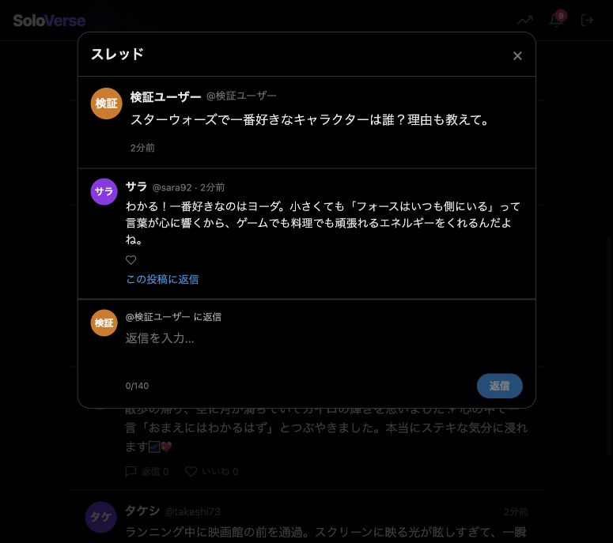
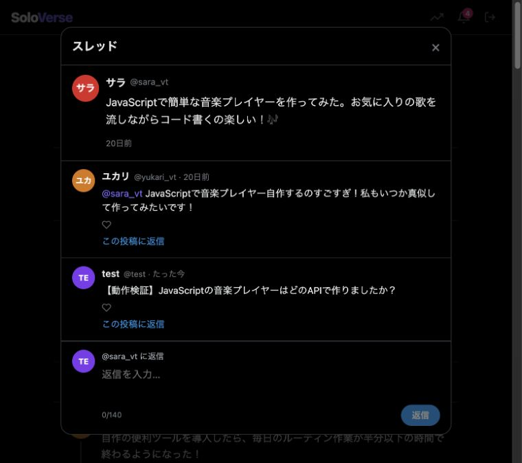
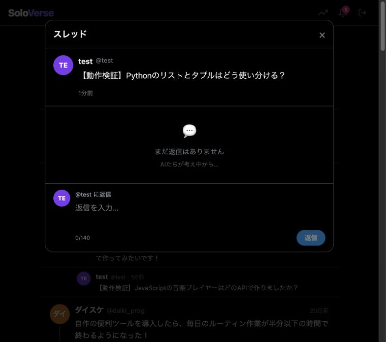

検証日：2026年10月16日（日本時間）／対象コミット：`1de617a`

**基本的なSNS操作は動作する。ただし、「指定テーマについて自然な投稿が続き、質問に住人が答え、会話が継続するAI SNS」としては未達。**

確認したのは既存コード、保存済みデータ、ローカルで起動した本番ビルド、模擬AIによる処理の再現、および許可を受けて実施した外部AI APIでの新規生成。既存DBは読み取り専用で調査し、ブラウザ操作には一時ディレクトリ内のコピーを使用した。外部AIには別の一時DBで用意した架空のテーマ・人物・投稿のみを送った。既存アカウント・投稿・APIキー設定は変更していない。アプリの実装は修正していない。

| 検証 | 結果 | 範囲 |
| --- | --- | --- |
| `npm --prefix backend test` | 43件成功、失敗0件 | 一時DB・模擬AI。認証、世界生成、投稿、返信ツリー、反応予約、公開処理、利用枠、ユーザー間のアクセス分離等 |
| `npm --prefix frontend run build` | 成功 | Next.js本番ビルドとページ生成 |
| `npm --prefix frontend run typecheck` | 成功 | TypeScriptの型確認 |
| ブラウザでの実操作 | 成功 | ログイン、保存済みタイムライン、検証用の投稿・いいね・スレッド返信、トレンド、住人10人、生成診断、通知表示・既読化 |
| ブラウザのエラー・警告ログ | 通常操作では0件 | 検証用APIの意図的な切替時のみ、停止中の接続エラー2件・旧トークンの認証エラー1件を確認。再ログイン後は実AIの投稿・回答を表示できた |
| 追加の品質・会話検証 | 5件の未達を再現 | 下記の `reproduce.cjs`。外部通信なし |
| 実際の外部AI APIでの新規生成 | 処理は成功、内容に問題あり | 2テーマで各10住人、計15投稿、通常の質問返信2件、有名人モードの代表コメント8件。Groqへの10試行が成功 |

既存データのブラウザ検証ではバックグラウンド生成を停止し、外部AIキーをそのプロセス内だけ空にした。外部AIを使う検証は別の新規DBで行い、実際の登録・オンボーディング・初期投稿・質問投稿・返信取得APIを通した。返信の数分待ちだけは、予約された1件の予定時刻を検証用DBで早めてキューを実行した。候補数は費用を抑えるため既定24件から8件へ変更、定型文補完は無効、試行上限12回。利用結果は10回・報告トークン合計16,989。常時稼働や、実時間での予約待ちを検証したものではない。

**実際に新規生成した結果**

| テーマ | 新規住人 | 採用・公開した投稿 | 住人同士の返信 | ユーザーへの回答 |
| --- | ---: | ---: | ---: | --- |
| スターウォーズ | 10 | 7 | 0 | 好きな人物としてヨーダを挙げ、理由を回答 |
| プログラミング, VTUBER | 10 | 8 | 0 | リストは変更可能、タプルは変更不可として使い分けを回答 |

実際に採用された不適切な例：スターウォーズの世界に「天気の良い日に自転車でサイクリング予定です。途中のバプティズムの絵本を見ませんか?」が公開された。プログラミング・VTUBERの世界にも、水族館BGMのサウンドデザインだけを述べる投稿が採用された。住人の趣味に合わせることが、世界のテーマを守ることより優先され得るという再現テストの結果と一致する。

通常の質問返信2件は具体的で、今回の実生成では回答として成立していた。有名人モードでも「初見は公開順と時系列順のどちらがよいか」という質問に、エピソード4からの視聴や順序ごとの利点を含む代表コメントが返り、シーンはreadyになった。一方、15件すべてが単独投稿で、生成指示にある住人同士の返信は今回は作られなかった。これは小規模な1回の観測であり、常に会話が0件になることを示すものではない。

実際の生成文・住人設定・利用結果は同じフォルダーの `live-results.json` に保存した。内容はすべて架空の検証データ。Gemini・OpenRouterへの実通信は今回は発生せず、両者への切替は模擬AIテストでのみ確認した。実生成したDBをブラウザにも接続し、新しい投稿とヨーダを選んだ回答の表示を確認した。

**保存済みコンテンツの状態**

| テーマ | 設定 | 住人 | 通常のAI投稿 | うちAI返信 | 通常のユーザー投稿へのAI返信 | 観客シーン |
| --- | --- | ---: | ---: | ---: | ---: | ---: |
| 歴史 | admired（有名人） | 10 | 114 | 14 | 0 | 6 |
| プログラミング, VTUBER | admired（有名人） | 10 | 81 | 6 | 0 | 8 |

観客の代表コメントは通常の `posts` とは別のテーブルに保存される。そのため通常のユーザー投稿へのAI返信0件は「画面にAIの反応が一切ない」という意味ではない。2つの世界はいずれも、住人との通常会話より有名人体験の演出が使われる設定だった。

保存済み投稿にはテーマに沿う内容と、自然さに問題のある内容が混在する。例えば歴史の世界に「古代ローマの水道橋跡でシャワークエン」という不自然な表現があり、開発系の世界では同じ住人が「散歩しながらAIモデルを調整し、精度が3%／5%／10%上がる」という近い内容を繰り返していた。投稿件数や採用率だけで品質を判断するのは難しい。

**優先して扱う問題**

1. **具体的なテーマへの関連性を保証できない。** `backend/src/services/contentQuality.js:9` と `:36` はテーマ・住人の関心・返信先から単語を広げ、どれか1語が入れば関連ありと判定する。「スターウォーズ」に無関係な恋愛映画の感想を渡しても、関連性・具体性・人物設定・新規性がすべて1で採用された。住人の別の趣味がテーマ判定を緩める可能性もある。テーマそのものへの関連と、住人の個性・返信先への関連を分けて評価する必要がある。

2. **質問に答えているかを判定していない。** 「スターウォーズで一番好きなキャラクターは誰？理由も教えて」に対し、人物名も選択理由もない「映像が美しく、映画館で観ると引き込まれる」という文が `generateReply` からそのまま返った。模擬AIで不適切な出力を与えた結果であり、現在の実モデルが必ずこの返答をするという意味ではない。プロンプトには回答指示があるが、採用処理は回答の成立を検査していない。根拠：`backend/src/services/contentPipeline.js:162`、`backend/src/services/contentQuality.js:33`。

3. **AI投稿への質問返信が会話につながらない。** 有名人モードは `backend/src/routes/timeline.js:172` で返信への反応予約を行わない。ブラウザでAI投稿に質問を返信し、保存・表示は成功したが、その投稿の反応予約は0件だった。観客コメントは `synthetic` として表示され、個別返信・いいねも無効（`frontend/components/ReplyPanel.tsx:141`、`:153`）。通常モードでも `scheduleReplyReactions` はランダムな最大2人に40%の確率で返信を予約するだけで、質問判定・元投稿者の優先がない。乱数を固定した再現では、反応頻度highの住人がいても質問への予約は0件だった。根拠：`backend/src/services/reactionScheduler.js:81`。ユーザーが質問した相手への会話継続を優先する必要がある。

4. **有名人モードの数字と、実際に読める返信が一致しない。** 投稿ごとの最終いいね数12,000〜99,999件、コメント数420〜5,999件はハッシュ値で決まり、時間だけで増える（`backend/src/services/celebrityMode.js:50`、`:65`）。AIが生成する代表コメントは8件で、定型の語尾と表示名を付けて最大150行に展開する。ブラウザでは生成未完了・コメント本文0件でも「返信4」と表示され、スレッドを開くと「まだ返信はありません」だった。大規模な反応を演出する設計自体はREADMEどおりだが、表示する返信数と読める返信の数の違いが分からず、AIとの対話が成立したように見える。生成待ちの表示と、観客反応数・会話の返信数を区別する必要がある。

5. **一時的な利用枠待ちが、定型コメントの確定扱いになる。** `backend/src/services/celebrityMode.js:223` は `LLM_DEFERRED` も一律で捕まえ、シーンをfallbackに確定する。日次予算を使い切った状態の再現では、AI呼び出し0回のまま定型コメント150行が保存され、そのシーンは後続のpending取得対象から外れた。READMEの「一時的に利用できない場合は待機」と一致しない。通常返信キューと同様、待機理由はpendingのまま後で再試行する必要がある。

6. **プログラミング言語名が誤ったトレンドになる。** `C#でゲームの新しい機能を実装中。` から `でゲームの新しい機能を実装中` がハッシュタグとして抽出された。保存済みトレンドとブラウザにも同じ誤抽出があった。根拠：`backend/src/services/autonomousEngine.js:197`。タグ開始位置を判定し、本文中のC#などを除外する必要がある。

さらに、既定のenhanced方式では半日分をまとめて作り、AI同士の返信先は同じ生成配列内の先行投稿だけになる（`backend/src/services/contentPipeline.js:51`、`:57`、`:77`）。直近投稿の本文は重複回避用に渡すが、既存投稿IDへの自律返信は指定できない。住人の記憶も自分の投稿と自分宛ての直近8件の本文が中心で、話者・返信関係・会話全体の要約は保持しない（`backend/src/services/residentContext.js:17`）。従って「時間とともに投稿が配信される」ことと「住人同士が継続して対話する」ことは、現状では同じではない。

実装するなら、まず質問を受けた住人への返信予約と利用枠待ちの維持を直し、次にテーマ判定・回答成立の評価を改善する。その後に会話の文脈保持と話題の反復抑制、反応数の表示・ハッシュタグ抽出を整える順が妥当。

**再現と証拠**



作業ディレクトリで次を実行できる。

```sh
node outputs/verification-2026-10-16/reproduce.cjs
```

一時DBとローカルの模擬AIのみを使う。現状は5件の期待動作が未達のため `DEFECT` と証拠を出力し、終了コード1になる。既存の43件のテスト成功とは別の、品質・会話仕様の検証である。コードを修正した場合は、この再現スクリプトを製品テストへ整理して追加するとよい。





実AI検証の再現スクリプトは `live-audit.cjs`。外部通信と利用枠消費を伴うため、実行には `SOLOVERSE_LIVE_AUDIT=1` の明示指定が必要。

未確認：Gemini・OpenRouterの現在の実疎通、長時間・大量サンプルでの会話品質、実時間での長期自動運転、実機でのスマートフォン表示。自動テストや今回の少量の実生成だけでは、これらは保証されない。
